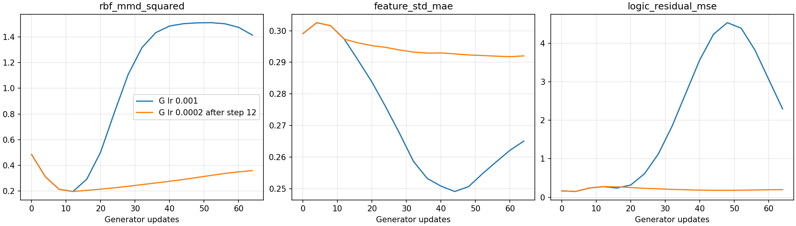
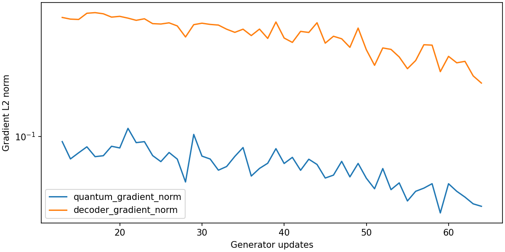

# Lower generator learning-rate experiment

Executed `GAN_06_SSW_lower_generator_lr.ipynb` through step 64, resuming the
shared step-12 checkpoint. Generator Adam learning rate changed from 0.001
to 0.0002 after restoring optimizer state. Discriminator rate stays 0.001,
with one discriminator update per generator update. Architecture, batch size
four, data noise and fixed evaluation latent inputs remain unchanged.

| Checkpoint | Validation MMD² | Mean MAE | Std MAE | Pattern coverage | Logic residual MSE |
|---|---:|---:|---:|---:|---:|
| Shared start, step 12 | 0.1967 | 0.3113 | 0.2973 | 5 | 0.2744 |
| Original G rate, step 64 | 1.4134 | 1.3394 | 0.2651 | 2 | 2.2937 |
| Lower G rate, step 64 | 0.3592 | 0.4338 | 0.2920 | 5 | 0.1976 |

Lowering the generator rate moderates deterioration in this continuation,
but does not improve validation MMD over the starting checkpoint. Best
checkpoint remains **step 12**. Feature spread barely improves. At step 64,
381 of 400 generated vectors threshold to pattern 1001 (95.25%); coverage of
five patterns therefore conceals severe concentration. Threshold assignments
do not establish satisfaction of the world's feature equations.

Quantum gradient L2 norms range from 0.0338 to 0.1119, median 0.0681.
Decoder gradient norms range from 0.2125 to 0.5762, median 0.4388.
Both are finite and nonzero throughout the 52 new updates. This supports a
working gradient path, but neither their relative size nor nonzero quantum
gradients proves useful quantum learning. The parameter groups have different
sizes and scales.

The notebook verifies saved optimizer learning rates, 64 updates in both
optimizers and finite gradient diagnostics. Execution completed without errors;
the execution runner verified its protected earlier notebooks were unchanged.
Results and checkpoints are in `ssw_gan_lower_lr_results`.

These are fixed noiseless evaluation diagnostics. No supplementary finite-shot
evaluation was run for this trial. Training measurement sampling is unseeded,
and this is one continuation, not evidence of an effect across random seeds.
There were 256 real-example draws with replacement, less than one epoch.

The next diagnostic should compare trainable versus frozen quantum weights,
with the same decoder setup and evaluation, to test the circuit's contribution
to learning. Stabilization alone has not yet produced a useful generator.

