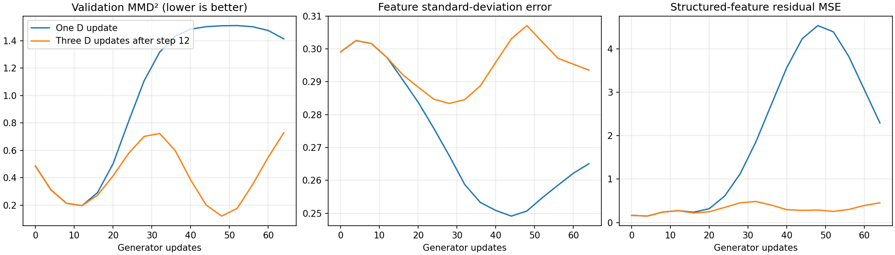
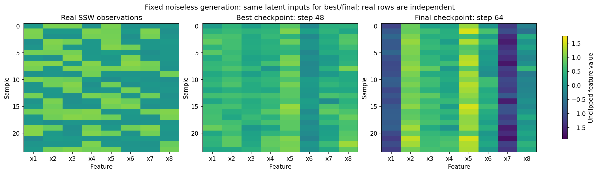

# SSW discriminator-update experiment

Executed `GAN_05_SSW_discriminator_updates.ipynb`, continuing the saved step-12
model through step 64. Only the discriminator update ratio changed: three
updates reuse the same real/generated minibatch before each generator update.
The quantum generator, decoder, latent prior, learning rates, batch size four,
SSW v1.0 observations and evaluation inputs remain unchanged. No encoder was added.
No hardware noise model was added; the dataset retains its specified observation noise.

| Checkpoint | Validation MMD² | Mean MAE | Std MAE | Thresholded pattern coverage | Logic residual MSE |
|---|---:|---:|---:|---:|---:|
| Shared starting model | 0.1967 | 0.3113 | 0.2973 | 5 | 0.2744 |
| Three D updates: best (step 48) | 0.1205 | 0.1832 | 0.3071 | 15 | 0.2882 |
| One D update: final | 1.4134 | 1.3394 | 0.2651 | 2 | 2.2937 |
| Three D updates: final | 0.7283 | 0.6107 | 0.2935 | 4 | 0.4542 |

Selected best checkpoint: step **48**. Selection uses validation
MMD² only. Pattern assignments threshold the first four generated features;
they do not establish that the generated vectors satisfy the world's equations.
The residual is an additional diagnostic, not the training objective.

The best MMD² improved from 0.1967 to 0.1205, but feature spread and logical
consistency did not improve. Final-step deterioration remains substantial.
This intervention did not establish stable convergence. Actual finite-shot
evaluation agrees closely: best MMD² 0.1197 and final MMD² 0.7243.

Validated: inherited history/losses match the original run, all notebook code
cells executed without errors, and saved optimizer counters record 64 generator
updates and 168 discriminator updates (12 initial + 52 × 3). Training used
256 real-example draws with replacement, not a complete training epoch.

This is one stochastic continuation. Unseeded quantum sampling prevents exact
replay and the comparison does not establish an effect across random seeds.
Review both final and best checkpoints; the notebook's initial sample figure
uses the selected best checkpoint.

Finite-shot diagnostic: `ssw_gan_d3_results/sampled_evaluation.json`.
